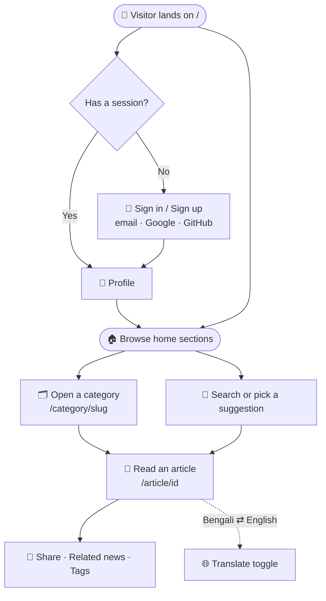

# 📰 Bangla News 24

### সত্য ও বস্তুনিষ্ঠ সংবাদ · *Truthful and objective news*

A modern, **Bengali-first** news portal built with **Next.js 16**, **React 19**, **Tailwind CSS v4**, **HeroUI v3**, and **better-auth** on **MongoDB**.

All news content is pulled from an external, read-only API — there is no local news database. Accounts, sessions, and profile data live in MongoDB via better-auth.

<p align="center">
  
  
  
  
  
  
  
  
</p>

---

## 🖼 Preview

> 📸 **Screenshots coming soon.** See [`docs/screenshots/`](docs/screenshots/README.md) for a capture guide — add `home.png`, `article.png`, and `search.png`, then uncomment the grid below.

<!-- Uncomment once the images exist:
| 🏠 Home | 📄 Article | 🔎 Search |
| :---: | :---: | :---: |
|  |  |  |
-->

---

## 📑 Table of contents

- [🖼 Preview](#-preview)
- [✨ Features at a glance](#-features-at-a-glance)
- [🗺 How a reader moves through the app](#-how-a-reader-moves-through-the-app)
- [🧩 Functionality in detail](#-functionality-in-detail)
- [🧱 Feature → code map](#-feature--code-map)
- [🛠 Tech stack](#-tech-stack)
- [🚀 Getting started](#-getting-started)
- [🔑 Environment variables](#-environment-variables)
- [📜 Scripts](#-scripts)
- [🗂 Project structure](#-project-structure)
- [🧭 Routes](#-routes)
- [⚙️ How it works](#️-how-it-works)
- [🩹 Troubleshooting](#-troubleshooting)
- [☁️ Deployment](#️-deployment)

---

## ✨ Features at a glance

| | Feature | Summary |
| :-: | --- | --- |
| 🏠 | **Home page** | Featured hero story, latest rail, most-read, and curated category sections |
| 🗂 | **Category listings** | `/category/[slug]` with a featured lead, card grid, and pagination |
| 📄 | **Article pages** | Rich-text body, byline, reading time, source, tags, share, related news |
| 🔎 | **Search** | Deep server-side corpus, live suggestions, and paginated results |
| 🚨 | **Breaking ticker** | Auto-scrolling marquee of the latest headlines |
| 🔐 | **Authentication** | Email/password + Google + GitHub OAuth, guarded profile |
| 🇧🇩 | **Bengali-first UI** | SolaimanLipi font, `bn-BD` dates, Bengali numerals |
| 🌐 | **Translate toggle** | One-click Bengali ⇄ English via Google Translate, cookie-persisted |

---

## 🗺 How a reader moves through the app



- **Public** browsing (home, categories, articles, search) needs no account.
- **Private** routes (`/profile`, `/profiledata`) redirect to `/sign-in` when there's no session.
- The **translate toggle** in the header works on any page and persists via cookie.

---

## 🧩 Functionality in detail

### 🏠 Home page (`/`)

Composed from four server-rendered sections in `src/components/homepage/`:

- **Hero / Main news** — the lead story, visually dominant in a two-column grid.
- **Latest rail** — a vertical list of the freshest headlines beside the hero.
- **Most read** — the portal's most-read stories, fetched from the most-read endpoint.
- **Selected sections** — curated blocks driven by `/api/news/sections`.

### 🗂 Category listings (`/category/[slug]`)

- Page 1 leads with a **featured story** (full-width card) followed by a grid; deeper pages render a pure grid.
- **Pagination** is validated (`?page=`) and clamped: the category API caps out at 24 items per page and 40 pages, so `hasMore` is verified by peeking at the start of the next page.
- An empty first page means the category doesn't exist → `notFound()`.

### 📄 Article pages (`/article/[id]`)

- Renders a heterogeneous **rich-text body**: paragraphs, images, and subheadings.
- Handles BBC-style **rich-text objects** (`{ blocks: [...] }`) by flattening them to plain text.
- **De-duplicates the lead image** — the API returns the hero twice (as `imageUrl` and as the first body image), so the two are normalized and compared to avoid showing it twice.
- Shows byline/author avatar, **Bengali-formatted date**, **estimated reading time** (words ÷ 200), a source link, tags, **share buttons**, and **related articles**.
- Generates dynamic **Open Graph + SEO metadata** per article.

### 🔎 Search

- **Search pool** (`src/lib/news-pool.ts`) — because `/api/news` only exposes ~45 articles, the searchable corpus is built from the latest feed **plus the first two pages of every scrapable category** (~340 articles), deduped by id, sorted newest-first, and **memoized per process for 5 minutes** with in-flight request sharing.
- **Matching** (`src/lib/search.ts`) — case-insensitive substring match on title + description, mirroring the API's own `q` semantics.
- **Live suggestions** — `/api/suggest?q=` returns up to 5 trimmed suggestions for the navbar dropdown. Runs server-side because the news API sends no CORS headers.
- **Results page** (`/search?q=`) — paginated grid with result counts in Bengali numerals; out-of-range pages clamp to the last page.

### 🚨 Breaking news ticker

A red, full-width marquee of the latest headlines (`src/components/shared/BreakingNews.tsx`). The track auto-scrolls via a CSS keyframe animation and **pauses on hover**. Renders nothing when there are no headlines.

### 🔐 Authentication

- **Providers:** email/password, Google, and GitHub — configured in `src/lib/auth.ts`.
- **Client:** `src/lib/auth-client.ts` exposes `signIn`, `signUp`, `signOut`, `updateUser`, and `useSession`.
- **Guarding:** `src/proxy.ts` (Next.js 16's renamed middleware) redirects unauthenticated users away from `/profile`; the profile pages also self-guard with `redirect("/sign-in")`.
- **Profile:** an authenticated view plus an update form; friendly, Bengali error messages via `src/lib/auth-error.ts`.

### 🇧🇩 Bengali-first experience

- **Body font** — SolaimanLipi (`public/fonts/SolaimanLipi.ttf`), declared in `globals.css`.
- **Numerals** — `toBnDigits()` converts `0-9` → `০-৯` everywhere numbers appear.
- **Dates** — `formatBnDate()` renders `bn-BD` long dates, guaranteeing Bengali numerals.

### 🌐 Bengali ⇄ English translation

A header toggle (`src/components/shared/TranslateButton.tsx`) that flips the whole page between Bengali and English using Google's website translator. The choice is stored in the `googtrans` cookie so it survives navigation and reloads, and the injected widget chrome is hidden via CSS.

---

## 🧱 Feature → code map

Jump straight to the code behind each feature.

| Feature | Key files |
| --- | --- |
| **Layout shell** (header, navbar, ticker, footer) | `src/app/layout.tsx`, `src/components/shared/{Header,Navbar,Footer,BreakingNews}.tsx` |
| **Home sections** | `src/components/homepage/{HomePage,MainNews,RelatedNews,MostReadingNews,SelectedNews}.tsx` |
| **Category listing** | `src/app/category/[categoryId]/page.tsx` |
| **Article detail** | `src/app/article/[id]/{page,ArticleBody,ShareButtons,RelatedArticles}.tsx` |
| **Search + suggestions** | `src/app/search/page.tsx`, `src/app/api/suggest/route.ts`, `src/lib/{news-pool,search}.ts` |
| **News API layer** | `src/lib/news.ts`, `src/types/news.ts` |
| **Auth (server / client / guard)** | `src/lib/auth.ts`, `src/lib/auth-client.ts`, `src/proxy.ts`, `src/components/auth/AuthShell.tsx` |
| **Profile** | `src/app/(auth)/profile/page.tsx`, `src/app/profiledata/page.tsx`, `src/components/profile/*` |
| **Bengali helpers** | `src/lib/bn.ts` |
| **Global styles / fonts** | `src/app/globals.css` |

---

## 🛠 Tech stack

| Layer | Choice |
| --- | --- |
| **Framework** | Next.js 16 — App Router, Turbopack |
| **UI** | React 19, HeroUI v3, Tailwind CSS v4 |
| **Auth** | better-auth (MongoDB adapter) |
| **Database** | MongoDB |
| **Language** | TypeScript |
| **Lint** | ESLint (flat config) |
| **News data** | `https://news-api-v2.vercel.app` (external, read-only) |

---

## 🚀 Getting started

### Prerequisites

- **Node.js** 20+
- A **MongoDB** connection string (local or Atlas)
- **Google** and **GitHub** OAuth apps *(optional — only for social sign-in)*

### 1. Install

```bash
npm install
```

### 2. Configure environment

Create a `.env` file in the project root (it's gitignored — **do not commit it**). See [Environment variables](#-environment-variables).

### 3. Run the dev server

```bash
npm run dev
```

Open **[http://localhost:3000](http://localhost:3000)**. 🎉

---

## 🔑 Environment variables

| Variable | Required | Purpose |
| --- | :---: | --- |
| `BETTER_AUTH_SECRET` | ✅ | Signing secret for better-auth |
| `BETTER_AUTH_URL` | ✅ | Base URL (also used to build article share links) |
| `BETTER_AUTH_MD_URI` | ✅ | MongoDB connection string — note the **`MD`** spelling |
| `GOOGLE_CLIENT_ID` | ⬜ | Google OAuth client id |
| `GOOGLE_CLIENT_SECRET` | ⬜ | Google OAuth client secret |
| `GITHUB_CLIENT_ID` | ⬜ | GitHub OAuth client id |
| `GITHUB_CLIENT_SECRET` | ⬜ | GitHub OAuth client secret |

```dotenv
BETTER_AUTH_SECRET=your_auth_secret
BETTER_AUTH_URL=http://localhost:3000
BETTER_AUTH_MD_URI=mongodb://localhost:27017
GOOGLE_CLIENT_ID=your_google_client_id
GOOGLE_CLIENT_SECRET=your_google_client_secret
GITHUB_CLIENT_ID=your_github_client_id
GITHUB_CLIENT_SECRET=your_github_client_secret
```

> ⚠️ `src/lib/auth.ts` **throws at import time** if `BETTER_AUTH_MD_URI` is missing, and hardcodes the database name `better-auth`.

---

## 📜 Scripts

| Command | Description |
| --- | --- |
| `npm run dev` | Start the dev server on port 3000 |
| `npm run build` | Create a production build |
| `npm run start` | Serve the production build |
| `npm run lint` | Run ESLint |
| `npx tsc --noEmit` | Typecheck (no dedicated script) |

> ℹ️ There is **no test runner or test suite** in this project.

---

## 🗂 Project structure

```
src/
├── app/                      # App Router pages
│   ├── (auth)/               # sign-in, sign-up, profile  (route group)
│   ├── api/
│   │   ├── auth/[...all]/    # better-auth handler
│   │   └── suggest/          # live search suggestions
│   ├── article/[id]/         # article page + body, share, related
│   ├── category/[categoryId] # category listing (by slug)
│   ├── search/               # search results
│   ├── profiledata/          # authenticated profile page
│   ├── layout.tsx            # header, navbar, ticker, footer
│   ├── not-found.tsx         # 404 (৪০৪)
│   └── <section>/            # placeholder section routes
├── components/
│   ├── homepage/             # hero, latest, most-read, sections
│   ├── shared/               # header, navbar, footer, cards, ticker
│   ├── profile/              # profile view + update form
│   ├── search/               # search input
│   └── auth/                 # auth shell / layout
├── lib/                      # news API, search pool, auth, Bengali helpers
├── types/news.ts             # all news / API types
└── proxy.ts                  # auth middleware (Next 16 convention)
```

---

## 🧭 Routes

| Route | Type | Purpose |
| --- | :---: | --- |
| `/` | Page | Home page |
| `/category/[slug]` | Page | Category listing (e.g. `/category/politics`) |
| `/article/[id]` | Page | Article detail |
| `/search?q=...` | Page | Search results |
| `/sign-in` · `/sign-up` | Page | Authentication |
| `/profile` | Page 🔒 | Profile (auth-guarded) |
| `/profiledata` | Page 🔒 | Profile (auth-guarded) |
| `/api/suggest?q=...` | API | JSON search suggestions |
| `/api/auth/[...all]` | API | better-auth endpoint |

> 📝 The top-level routes `/politics`, `/sports`, `/world`, `/country`, `/technology`, `/health`, and `/economics` are **placeholders**; live listings live under `/category/[slug]`.

---

## ⚙️ How it works

### 📡 News data

News is fetched inline in server components with `next: { revalidate: 3600 }` (ISR-style, one-hour cache). Endpoints in use:

```
/api/news · /api/news/sections · /api/news/most-read
/api/categories · /api/category/:slug · /api/article/:id
```

Every response is wrapped as `{ data: ... }`, and all fetch helpers live in `src/lib/news.ts`. Because the API sends **no CORS headers**, the browser can't call it directly — search runs server-side.

### 🔎 The search corpus

`/api/news` only reveals ~45 articles, so a naive search would miss anything older. Instead:

1. Fetch the latest feed + the first **2 pages** of every **scrapable** category.
2. Merge and **dedupe by id** (stories appear in multiple categories).
3. **Sort newest-first** by publish date.
4. **Memoize** the result per process for 5 minutes, sharing one build across concurrent requests.

Tuning knobs (`CATEGORY_PAGES`, `PAGE_SIZE`, `CATEGORY_MAX_LIMIT`, `CATEGORY_MAX_PAGE`) live in `src/lib/news-pool.ts` and `src/lib/news.ts`.

### 🔐 Auth flow

```
better-auth (server)  →  src/lib/auth.ts
better-auth (client)  →  src/lib/auth-client.ts
middleware guard      →  src/proxy.ts   ← Next 16 renamed middleware.ts → proxy.ts
```

`proxy.ts` exports **`proxy`** (not `middleware`) plus a `config.matcher`; its matcher currently guards `/profile`.

---

## 🩹 Troubleshooting

| Symptom | Likely cause & fix |
| --- | --- |
| `BETTER_AUTH_MD_URI is not defined` at startup | The env var is missing/misspelled. It's **`MD`**, not `MONGODB`. |
| Images throw at runtime | The image host isn't allowlisted. Add a `remotePatterns` entry in `next.config.ts`. |
| Profile keeps redirecting to sign-in | No active session — sign in first, and confirm `BETTER_AUTH_URL` matches the origin you're browsing. |
| OAuth login fails | Callback URL mismatch — register `{BETTER_AUTH_URL}/api/auth/callback/{provider}` in the provider's console. |
| Search misses older stories | The pool only reaches the first `CATEGORY_PAGES` pages per category — raise it in `src/lib/news-pool.ts` (costs more API calls). |
| Auth middleware seems missing | It lives in `src/proxy.ts`, not `middleware.ts` (Next.js 16 convention). |

---

## ☁️ Deployment

1. Push to your Git host and import the repo on **Vercel** (or any Node host).
2. Set **all** environment variables in the deployment environment.
3. Point OAuth callback URLs at the deployed `BETTER_AUTH_URL`.

> ⚠️ `next/image` remote hosts are allowlisted in `next.config.ts` — only **`ichef.bbci.co.uk`** is permitted today. Add a `remotePatterns` entry before introducing image URLs from other hosts, or images will throw at runtime.

---

<p align="center"><sub>Built with ❤️ for Bangla readers · <b>Bangla News 24</b></sub></p>
